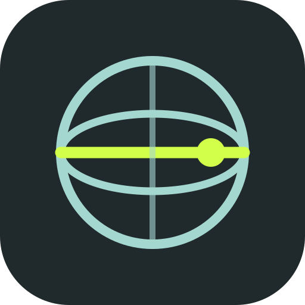

# Latitude

A local screen recorder built around clear podcast audio. Version **0.9.4 — Windows beta and Linux preview**.

[Beta homepage](https://latitude.pictures) · [Discord feedback and updates](https://discord.gg/EnPRdDutAn)

[Desktop downloads](https://github.com/zphat/Latitude/releases) · [Report a bug](https://github.com/zphat/Latitude/issues) · [Contributing](CONTRIBUTING.md) · [Modding](MODDING.md)

Record your screen, optional facecam, microphones, and desktop audio. Shape your voice in a focused audio studio, arrange sources directly in the preview, and export synchronized isolated tracks for editing. No account or streaming setup is required to record.

## Open the Windows app

1. Download **Latitude-0.9.4-Windows-x64-Setup.exe** from [Releases](https://github.com/zphat/Latitude/releases/tag/v0.9.4).
2. Double-click it. Latitude installs for your Windows account and creates desktop and Start menu shortcuts.
3. Open either shortcut. No terminal, source folder, Node.js, OBS, or separate FFmpeg installation is needed.

Recordings stay in your chosen folder (initially `Videos\Latitude`). Windows Settings → Apps can uninstall Latitude; preferences and recordings are retained. From 0.9.1 onward, Latitude checks once at launch and offers **Update now** or **Skip until next launch**. You can also check in **Settings → App updates**. To move from 0.9.0 or earlier, install the current version manually once.

The optional ZIP is for portable use. Extract the **whole** ZIP and keep its runtime files together. A shortcut to its Latitude.exe works; moving only the EXE breaks that portable copy. The installer is recommended for everyday use.

The beta is unsigned, so Windows may identify it as an unknown publisher. It installs without administrator privileges. Use [BETA-TESTING.md](BETA-TESTING.md) for your first test and feedback.

## Open the Linux app

Download **Latitude-0.9.4-Linux-x86_64.flatpak** from [Releases](https://github.com/zphat/Latitude/releases/tag/v0.9.4), open it with Discover or a Flatpak-capable software center, install, then launch **Latitude** from your application menu. No source folder or development tools are needed. [Linux installation and testing guide](docs/LINUX.md).

The first Linux preview targets Fedora KDE/GNOME, Ubuntu/Mint with Flatpak, Bazzite, and SteamOS **Desktop Mode**. Gaming Mode and real-device performance remain unverified. Wayland uses the desktop screen-sharing portal; desktop audio uses PulseAudio or PipeWire 0.3.65+ with its PulseAudio service. The initial runtime download is shared with other Flatpak apps. Latitude is not on Flathub yet; preview updates come from GitHub Releases.

## New in Latitude 0.9.4

The optional Editor now fits smaller windows with a draggable preview/timeline divider, collapsible Media and Inspector panels, remembered layout and Reset layout. Keyboard divider controls and independent scrolling keep tools reachable while preserving the current edit. There are no new runtime dependencies or duplicate media players.

[Editor workspace guide](docs/EDITOR.md#arranging-the-workspace) · [Release notes](docs/releases/0.9.4.md) · [QA evidence and limits](docs/qa/editor-workspace.md).

Mac ARM64 and Intel packaging and bundled-encoder tests have passed in development-preview CI. Mac builds remain unsigned development artifacts; real-Mac capture tests, signing/notarization and public release are separate gates. [Mac status](docs/MACOS.md).

## New in Latitude 0.9.3

Clearer speech without added air: focused de-essing preserves more lower speech detail, and Podcast broadcast has restrained Rich clarity, no air boost and slightly gentler dynamics. Voice inputs remain mono and centered. Compression and the always-on sample limiters remain active by default; no new processing latency, dependencies or stereo widening were added.

Saved numeric settings are preserved. Choose **Podcast broadcast → Reapply** to use the revised starting point, then run **Soundcheck**. Reapply retains input gain, channel, mute and sync delay. The de-esser algorithm itself improves on every enabled voice chain, including saved profiles. Its live reduction readout shows when it is working.

Streaming FPS now comes from actual video encoder output. Technical details includes an on-demand performance snapshot. See [release notes](docs/releases/0.9.3.md), [QA evidence](docs/qa/voice-0.9.3.md), and the [performance and listening test guide](docs/PERFORMANCE.md).

## New in Latitude 0.9.2

The new near-black globe with lime latitude bands is used throughout the app, Windows desktop/Start menu icons, Linux launcher, and website. The original artwork and reproducible icon exports are included in [branding](branding/README.md). This is a branding update; recording and audio processing are unchanged. [Release notes](docs/releases/0.9.2.md).

## New in Latitude 0.9.1

**Launch update checks** with **Update now** and **Skip until next launch**, plus a manual check and opt-out in Settings. Downloads only start after you choose. Windows installed builds open the verified installer and close safely; Linux opens the verified Flatpak in your software center; portable builds open a ZIP for manual replacement. Recording, streaming and export prevent installation. Settings and the editor recovery draft save before handoff. No new production dependency or recurring background network checks.

[Update behavior and privacy](docs/UPDATES.md) · [Release notes](docs/releases/0.9.1.md).

## New in Latitude 0.9

**Latitude Editor** is the second official optional mod, included and off by default. Enable it in **Mods → Latitude Editor**, then open **Edit**, or choose **Edit** on a saved take.

- Layer video, audio, images and titles. Split/trim, drag between layers, insert intros or ads while keeping all later clips aligned, copy/cut/paste, and undo/redo. Separate a video's audio into a linked layer. Global range cuts preserve synchronization.
- Fades, dissolves, slides and wipes; drag/resize framing, crop, flip, opacity, simple color controls, and locally bundled Manrope/DM Serif Display title fonts with optional gradients.
- Clip/layer gain, panning, mute/solo, waveforms, optional dialogue cleanup, protected preview audio and two-pass podcast loudness export. Stateful dialogue processing spans the full edit, avoiding compressor resets at render boundaries.
- Export MP4, MKV or audio-only WAV. MP4/MKV optionally retain named audio layers **and aligned 24-bit WAV stems**. Portrait, square, 720p, 1080p and 4K projects at 24/30/60 fps.
- Non-destructive project files, local recovery drafts, missing-media relinking and cancelable native exports. Disabled editor code stays unloaded; idle previews stop; render jobs and undo memory are bounded. No new production dependency.

[Editor guide and limits](docs/EDITOR.md) · [Editor QA](docs/qa/editor-0.9.0.md) · [Release notes](docs/releases/0.9.0.md).

## New in Latitude 0.8

- **Live input and protected-output meters:** separate microphone bars, fixed dBFS color zones, numeric headroom, and an immediate red card outline only for the current clipping window (~27 ms at 48 kHz). A separate history reminder stays until Reset clips. Each channel shows its always-on limiter activity.

- **Latitude Streaming**, the first official mod, is included and off by default. Enable it in **Mods**, then open **Stream** in the sidebar. Connect one RTMP/RTMPS destination with its dashboard server URL and key.
- Stream the existing scene and processed stereo mix without recording to disk. Optional local recording keeps separate microphone/desktop tracks, with independent pause and stop controls.
- One H.264 encode for streaming, with hardware preference/software fallback. Bundled FFmpeg copies video and encodes the finished mix once to AAC. No new production dependency or capture/DSP graph. Simultaneous recording adds a second video encode.
- Preview status, bounded queues, three reconnect attempts, session-only keys, verified TLS, Twitch bandwidth test, and Twitch/YouTube/custom bitrate presets. Up to 1080p60, sharing the Studio canvas with local recording.
- Linux Flatpak now includes network permission; disabled streaming makes no connection. The editor arrived in 0.9; downloadable executable-mod installation remains planned.
- [Streaming setup and limitations](docs/STREAMING.md) · [QA report](docs/qa/streaming-0.8.0.md) · [Release notes](docs/releases/0.8.0.md). Authenticated platform delivery and real-speech listening still need beta feedback.

## New in Latitude 0.7

- Native screen detail is retained before cropping; output-aligned edges and deadline-based frame pacing improve picture clarity and cadence. Balanced 1080p30 targets 12 Mbps, with Efficient and High detail options.
- Static live previews skip unnecessary canvas paints; hidden paused previews stop drawing while retaining recording dimensions. No extra image filter or runtime dependency was added.
- Near-black themes, rounder controls, a refined globe, and record/pause/status controls next to the preview.
- A dedicated **Mods** page manages theme/layout packs and reviewed optional source modules. Version 0.8 adds the first Streaming mod to this foundation. Disabled modules stay unloaded. See [Modding](MODDING.md) and [0.7 release notes](docs/releases/0.7.0.md).

## New in Latitude 0.6

- Linux application-menu integration and a Flatpak installer, including its encoder and a small native desktop-audio bridge.
- Wayland portal selection without a second source-picker request; X11 keeps thumbnail selection.
- Linux default or specific output capture, independent of screen capture, using the existing audio processor and synchronized separate tracks. It leaves system defaults/volumes unchanged and removes its temporary input on disconnect or exit.
- Clear handling of older unsupported PipeWire versions, failed connections, and output changes. Windows loopback behavior remains available.
- Bounded encoder cancellation on Linux, plus tests against real PulseAudio/PipeWire servers and the installed app's audio path. These automated checks do not certify every distro, GPU, or capture device.

## New in Latitude 0.4

- **Normal installation:** desktop/Start menu shortcuts and uninstall support, with recordings kept separately.
- **Less unused processing:** inactive voice lanes sleep, disabled Rich clarity skips its filters, neutral EQ bands skip processing, meter logarithms run at meter rate, and unused audio contexts suspend. Static/hidden previews stop scheduling. Settings writes are debounced; text caches support all 40 layers within a 32 MiB budget.
- **Audio and capture fixes:** gain/mute changes preserve unchanged sync-delay buffers; bypass crossfades; headphone monitoring has a limiter. Device setup and recording start/stop are guarded against races. Frames are requested immediately after completed draws under one compositor clock.
- **Safer exports:** cancel without touching originals or earlier exports; live stage progress; atomic metadata updates; bounded video encoding threads; export and recording run separately to protect capture resources. Stalled writes and capture-stop timeouts finalize interrupted takes.
- **Daily polish:** input-clip history with Reset clips, Save and close, focused shortcut fallback, a smaller minimum window, and reviewable diagnostics with a GitHub feedback button. Nothing is uploaded automatically.

## New in Latitude 0.3

- **Click, drag, resize any source.** Corner handles preserve proportions; Shift switches aspect lock. Snap guides align edges and centers; Alt bypasses snapping. Scene layers has exact output-pixel position/size, crop, fit/fill, mirror, shape, opacity, visibility, lock, and layer order.
- **Text and graphics.** Add multiline titles with five fonts, size, bold/italic, alignment, solid or gradient colors, outline, and shadow. Add local PNG/JPEG/WebP images and gradient color panels. Up to 40 layers per scene. Editing handles are never recorded.
- **Undo, redo, duplicate, copy scene.** Each scene stores its own composition and crops. Video layers share existing screen A/B and camera streams, avoiding duplicate capture/audio. Preview editing locks during recording; explicitly unlock it for live adjustment.
- **Microphone-only onboarding.** Connect/test Voice 1 or skip. Templates are optional studio controls and replace the destination scene without changing audio processing. Saved microphones can reconnect on launch; disable this in Settings if preferred.
- **Five themes.** Signal pairs Sundial-inspired charcoal/green with prominent `#d1ff4a`. Dusk and Linen offer soft dark/light alternatives. Golden latitude pairs ocean ink with brass; Tide pairs deep teal with warm coral. Themes affect the interface, not recorded footage.
- **720p, 1080p, 1440p, or 4K at 30/60 fps.** Efficient, Balanced, and High detail bitrate choices, storage estimates, and automatic H.264 preference. H.264 capture exports by copying the picture stream; VP8 compatibility capture uses an H.264 export encode. Actual frame rate depends on devices and hardware.
- **Lower preview overhead.** Balanced/Economy previews render at up to 720p; Detailed at up to 1080p. Recording uses the selected full resolution. Static scenes redraw when changed; inactive pages stop live preview updates. Text has a bounded raster cache, unused decoded images and transition buffers are released, captures are shared, and disabled audio lanes do not send PCM copies to the writer. The compositor controls frame pacing without a second capture timer.
- **Portable compositions.** Packs include scene layers and local image assets. Images live outside preference JSON. Packs contain settings and image data, never executable code. MODDING.md documents the schema and experimental output-provider seam for source forks.

**Rich clarity** remains an optional voice enhancement: fuller body, less boxiness, and focused presence without an airy boost. Separate tracks, soundcheck, clipping warnings, voice processing, and final loudness/true-peak measurement remain central to Latitude.

## Your first recording

1. Name the session in the top bar.
2. Click **Choose a screen**, then select a monitor or window. Windows captures the default playback output. Linux captures the output selected in Inputs & outputs. Play something and verify the Desktop meter.
3. Open **Inputs & outputs**. Choose your microphone under Voice 1, and leave Voice 2 off unless needed. Click **Connect selected devices**.
4. If you want a facecam, click **Camera**, choose your webcam, and apply it. Its microphone is not automatically added. Camera is optional.
5. Open **Check** for a 12-second soundcheck. Stay quiet for three seconds, then speak naturally. Apply the suggestion if appropriate.
6. Pick **Natural voice** or **Podcast broadcast** in Voice Studio. Open a processing module for its controls. The **Rich clarity** slider adds fuller body, less boxiness, and focused vocal presence; start around 15–25% and toggle Clarity on/off to compare. It does not add an air shelf or remove noise underneath speech.
7. Choose a scene. Click a source to move/resize it, or use **Crop this source** in Scene layers to remove tabs/taskbar. **Add source** adds titles, images, and backgrounds. Click **Start recording**. Pause, add edit markers, and switch scenes as needed.
8. Stop. The original take is saved first. Automatic export then makes an editing pack; you can disable auto-export in Settings.
9. In **Takes**, use **Edit** to open synchronized picture and source audio in Latitude Editor, **Play** for your media player, or **Open files** for the session/export folder.

## What is implemented

- Screen or window capture; webcam; 720p, 1080p, 1440p, or 4K; selectable 30 or 60 fps.
- Five scene layouts: screen plus facecam, full camera, two screen views, screen only, and an editable intermission/title card.
- Cut, dissolve, and slide transitions; configurable transition duration; independently positioned/cropped sources; text and image overlays.
- Two microphone lanes, each with independent gain, mute, settings, and a mono isolated track.
- Left/right selection for stereo interfaces. Assign the same interface to both lanes with different channels for two microphones.
- Windows system loopback, Linux selected-output monitoring, or a selected virtual-cable/loopback audio input; stereo desktop gain/mute; optional speech-triggered ducking in the full mix.
- Monitoring output selection. Software microphone monitoring is for setup; it automatically stops when recording system audio to avoid duplicate capture. Use hardware direct monitoring when possible.
- Natural, Broadcast, Untreated room, Soft spoken, and Music/clean presets, remembered per input device.
- High-pass filter; four EQ bands; downward expander; soft-knee compressor; split-band de-esser; optional Rich clarity body/presence processing.
- Stereo-linked 5 ms lookahead sample-peak limiters on voices, desktop, headphone monitoring, and the full mix; raw clipping indicators; gain-reduction readout.
- Input delay adjustments of 0–500 ms for lip-sync correction when audio arrives early.
- Pause/resume, countdown with cancellation, scene hotkeys, markers, playback, quick mute-all, and small-window recording controls.
- Continuous disk writing, low-space stop, bounded write queue, large-file RF64 support, preserved originals, and recovery export for interrupted sessions.
- Two-pass loudness normalization of the final mix, with a report measuring the delivered mix’s actual loudness and true peak.

## Recording and export formats

Choose a preferred format in **Settings → Recording & export format**. Automatic export creates it after you stop. Live capture first saves recoverable MKV/WebM video and separate float WAV originals. It does not encode eight formats at once or put an expensive VP9 conversion in the live recording path.

**Keep microphone and desktop sources separate** defaults to on. Video outputs contain the full mix followed by named tracks for each recorded mic and desktop source. Audio-only outputs put the mix and each source in separate files. Turn it off for a mix-only delivery; the originals stay available.

| Format              | Good for                                      | Audio separation                 | Space and processing                                                            |
| ------------------- | --------------------------------------------- | -------------------------------- | ------------------------------------------------------------------------------- |
| **MP4 · suggested** | Everyday recording, CapCut and broad playback | Embedded AAC tracks              | Compact audio; H.264 picture copies without re-encoding when available          |
| **MKV · suggested** | Archive with lossless 24-bit audio            | Embedded FLAC tracks             | Audio larger than AAC, smaller than typical PCM; some editors require re-export |
| **MOV · suggested** | Editors needing uncompressed audio            | Embedded 24-bit PCM tracks       | Largest audio among the video choices; H.264 picture, not ProRes                |
| WebM                | Open web video                                | Embedded Opus tracks             | VP9 can save video space but conversion takes more CPU/time; size varies        |
| WAV                 | Audio editing                                 | One 24-bit PCM file per source   | About 1.04 GB/hour for a 48 kHz stereo mix; RF64 for large files                |
| FLAC                | Lossless audio masters                        | One 24-bit FLAC file per source  | Same decoded 24-bit samples as WAV, usually smaller for speech                  |
| MP3                 | Podcast delivery                              | One 192 kbps file per source     | About 86 MB/hour per file; lossy, broadly supported                             |
| M4A                 | Listening on phones/players                   | One 192 kbps AAC file per source | Roughly 86 MB/hour per file; lossy, check your host accepts it                  |

Video bitrate and duration matter more than the filename extension. Choose **Efficient** recording quality to reduce future capture size; MP4/MKV/MOV copy an existing H.264 recording at its existing quality. WebM conversion may reduce size, with a CPU/time cost and another lossy video generation. No format is always the smallest for every scene.

Turn off **Also save WAV editing files** and per-source video copies for a smaller export folder. That skips duplicate files and, when WAVs are off, normalizes directly into the final output without a temporary WAV. A new export never replaces older exports. Takes shows the last format, track/file count and total media size. The Play button opens the correct video or audio file, including old MP4 exports.

See [format details and technical references](docs/FORMATS.md). In-app notes describe each choice. The export dialog can remember a choice for future recordings or apply it to just one take.

## Editing in CapCut

With the default MP4, separate-sources and WAV editing choices, each **Export** folder contains:

| File                                           | Purpose                                                                                                          |
| ---------------------------------------------- | ---------------------------------------------------------------------------------------------------------------- |
| `Recording.mp4`                                | H.264 video. The first audio stream is the full mix. Further streams hold each enabled voice and desktop source. |
| `Voice 1.wav`, `Voice 2.wav`                   | Processed, isolated mono voices, when enabled. 24-bit PCM.                                                       |
| `Desktop.wav`                                  | Isolated stereo desktop sound, when enabled. 24-bit PCM.                                                         |
| `Mix.wav`                                      | The final stereo mix, with optional loudness normalization. 24-bit PCM.                                          |
| `Voice 1 original.wav`, `Voice 2 original.wav` | Floating-point voice backups before gain, EQ, compression, de-essing, and limiting. Source mute still applies.   |
| `Audio report.json`                            | Measured loudness, true peak, normalization mode, track list, and timing.                                        |
| `Markers.csv`                                  | Edit markers with times and labels.                                                                              |

CapCut versions differ in how they expose multiple audio streams embedded in one video. This app cannot add a stream selector to CapCut. The reliable editing workflow is to import the MP4 and isolated WAVs, place them at the **same timeline start**, mute the video’s mixed audio, and group/link the clips before cutting. Audio stems are captured on one sample clock and share the same duration.

For your preferred “different audio on each instance of the same clip” workflow, enable **A video copy for each isolated source** on export. The export adds `Voice 1 only.mp4`, `Voice 2 only.mp4`, and `Desktop only.mp4` as applicable. Each uses the same encoded video and one isolated soundtrack, so you can choose the version you want for each clip. This duplicates video storage but does not re-encode the picture.

Do not play all MP4 audio streams together. They contain the full mix plus its components. Use the mix **or** the isolated sources.

## Sound and routing notes

- Input gain starts at 0 dB. Aim for raw voice peaks around −12 to −6 dBFS. If the interface/microphone already clipped, lowering a software fader cannot restore it. Lower hardware gain.
- The live limiters protect **sample peaks** at −1.5 dBFS. They are not advertised as oversampled true-peak limiters. The final mix export uses FFmpeg’s loudness/true-peak processing and measures the encoded result. If the encoded mix overshoots the intended margin, the app flags it.
- The default final mix target is −16 LUFS. This is an adjustable starting point, not a guarantee of ideal loudness for every show. Silent material remains silent. Isolated stems are not separately normalized, preserving their relative balance for editing.
- Original voice backups cannot recover clipping that happened in hardware. Float storage preserves the captured samples; it does not turn a conventional mic/interface into a 32-bit-float recorder.
- A downward expander quiets gaps. It does not remove background sound while you speak. Optional browser noise suppression may help, but can alter the voice.
- Desktop ducking changes only the full mix. The desktop stem stays at its selected level. Muting a voice also mutes its original backup. Muting the **Full mix** alone leaves isolated tracks intact; **Mute all** mutes every source.
- Set the default Windows playback output **before** connecting the screen. If you change it, stop the take and reconnect capture. To record a specifically routed output, use a virtual cable or interface loopback input in the Desktop selector. Arbitrary WASAPI endpoint selection and per-app process capture are not implemented.
- Audio stems share one clock; camera/driver and browser capture latency can still affect A/V alignment. Make a clap test. Positive audio delay helps when audio arrives early. This build does not provide negative delay or automatic webcam latency correction.
- Device changes are made between takes. A disconnected source becomes silence or a blank picture region while other tracks continue; reconnect before the next take.
- Files can be large: Settings estimates video storage. All six audio originals together add up to roughly 6.9 GB/hour. Allow additional export space. Extra per-track video copies use additional space.

## Keyboard shortcuts

| Action                        | Shortcut                                          |
| ----------------------------- | ------------------------------------------------- |
| Start / stop                  | Ctrl + Shift + R                                  |
| Pause / resume                | Ctrl + Shift + P                                  |
| Mute Voice 1                  | Ctrl + Shift + M                                  |
| Add edit marker               | Ctrl + Shift + B; also B while the app is focused |
| Scenes 1–5                    | Ctrl + Shift + 1–5                                |
| Undo / redo edits             | Ctrl + Z / Ctrl + Shift + Z (or Ctrl + Y)         |
| Duplicate layer               | Ctrl + D                                          |
| Remove selected layer         | Delete / Backspace                                |
| Nudge selected layer          | Arrows; Shift for 10 output pixels                |
| Temporarily bypass snapping   | Alt while dragging                                |
| Toggle resize aspect behavior | Shift while dragging a corner                     |

Conflicts are shown in Settings; unavailable global bindings still work while Latitude is focused. Global shortcuts can be disabled there.

## Recovery

Every take lives in its own folder under your recording location, initially `Videos\Latitude`. The raw capture (`capture.mkv` for H.264, `capture.webm` for VP8), float WAVs, and `session.json` stay there after export.

If the app crashes, reopen it and look in **Takes** for an interrupted session. **Recover & export** repairs WAV sizes and attempts to process the partial capture. A partial/corrupted final video cluster may be unrecoverable, so recovery is best effort. Do not delete or rename session contents until your editing project is finished.

## What still needs real-world testing

This build has automated DSP, file-writing, export, and browser recording tests, including pause/resume, source mute, scene changes, synchronized stems, and four embedded audio streams. See `BUILD-REPORT.md` for the exact verification performed.

**Windows hardware capture, your webcam/mic drivers, output-device routing, global shortcuts in other programs, and long-session stability still need testing on your computer.** The Windows pipeline checks install, shortcuts, packaged launch, encoder availability, and uninstall; these do not exercise your real capture devices. The app is a desktop beta, not a claim of OBS-level reliability or commercial DAW mastering quality.

VST/AU hosting, AI restoration, per-application audio capture, simultaneous multiple webcams, independently recorded camera video, custom hotkey remapping, hardware video encoder selection, and automatic echo/latency correction are not included. The five scene slots are independent compositions, with up to 40 layers each. Each layer has its own crop. Templates replace the destination scene and legacy layout defaults. Applying a new template can reveal areas hidden by a previous crop, so review the preview before recording. The Linux x86-64 Flatpak is a preview; Fedora/Ubuntu real-device testing and SteamOS Desktop Mode testing are still needed. There is no macOS package. Electron and bundled FFmpeg make the download substantial; no claim that Latitude is smaller or faster than OBS has been benchmarked. Higher recording settings and extra sources use more resources.

For Linux-specific prerequisites, permissions, limitations, and build steps, see [the Linux guide](docs/LINUX.md).

## Run or modify the source

Install Node.js 22.12 or newer. In the source folder:

```sh
npm ci
npm run setup
npm start
```

The Windows source archive also includes `Start Latitude.cmd`, which performs setup on first launch. Source setup needs internet access to download dependencies. The packaged Windows app does not.

```sh
npm test                     # DSP, storage, and FFmpeg integration tests
npm run preview              # Browser interface preview, not a recording substitute
npm run pack:win             # Builds an unpacked Windows app; needs vendor/ffmpeg.exe
```

A Git checkout does not contain the encoder executable. On Windows, run `node scripts/prepare-encoder.cjs` after `npm ci` and before packaging. Run `npm run dist:win -- --publish never` to produce the Windows installer and optional portable ZIP. See [RELEASING.md](RELEASING.md) for the release procedure. CI checks source changes on Linux; the optional **Build Windows package** workflow creates a Windows test artifact without publishing a release.

`tests/audio-meters-ui.cjs` checks real AudioWorklet meter timing, known signal levels, limiter activity, reset behavior, and compact layout. `tests/ui.cjs` checks the recording/export pipeline; `tests/framing-ui.cjs` checks editing and actual cropped pixels; `tests/quality-ui.cjs` checks resolution, encoded frames, text, and output-provider lifecycle; `tests/formats-ui.cjs` checks format guidance, separate-source controls, saved defaults and per-export overrides; `tests/beta-ui.cjs` checks idle suspension, concurrent microphone setup, clip history, diagnostics, and compact windows. Install Playwright separately and provide `TAKE_TEST_BROWSER` if its Chromium is not in the usual location. It records synthetic media, checks pause/mute behavior, and verifies actual exports with `ffprobe`. `ffprobe` must be available for the integration tests. `TAKE_FFMPEG` can override the export binary during development.

Upgrading from Take Studio retains an existing local profile and recording folder when available. The internal `take://app` origin and IPC bridge name remain stable to preserve old preferences; they are not visible branding.

Architecture: secure Electron shell and IPC bridge; browser canvas scene compositor; one AudioWorklet graph for all audio tracks; direct incremental disk writer; FFmpeg for final encoding, loudness normalization, and muxing. Recording and export do not send your media to a service.

## Technical references

- Canvas frame capture: https://www.w3.org/TR/mediacapture-fromelement/
- Electron screen capture: https://www.electronjs.org/docs/latest/api/desktop-capturer
- Electron display-media and permission handling: https://www.electronjs.org/docs/latest/api/session
- FFmpeg loudness filters: https://ffmpeg.org/ffmpeg-filters.html#loudnorm
- CapCut audio import and mixing: https://www.capcut.com/tools/audio-mixing

Application source is MIT licensed. Bundled runtime and encoder components have their own licenses; see `THIRD-PARTY-NOTICES.md`.
